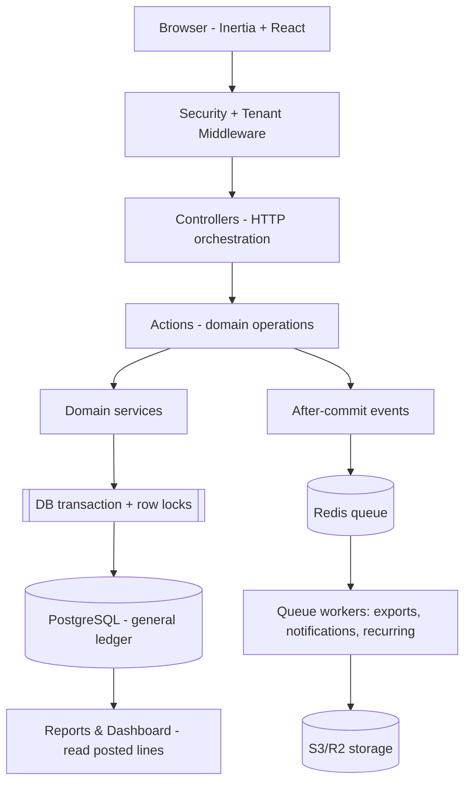
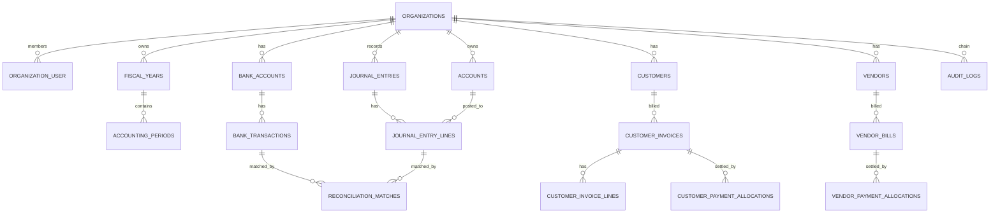

# Dualedge Accounting System

> A production-style, multi-tenant Laravel accounting platform built around a single double-entry general ledger as the source of financial truth.

**Project type:** Personal / portfolio project  
**Role:** Sole developer and architect (all commits authored by `jfsar` / John Sarmiento)  
**Timeline:** 2026-09-09 to 2026-10-14 (5 weeks, ongoing; 81 commits on `develop`)  
**Status:** Core accounting, AR/AP, banking, reporting, approval, audit, notifications, attachments, recurring journals, and the reliability infrastructure (durable outbox publication and a shared idempotency store) implemented.

## At a glance

|                    |                                                                                                           |
| ------------------ | --------------------------------------------------------------------------------------------------------- |
| **Backend**        | PHP 8.3, Laravel 13.17, Laravel Fortify 1.39                                                              |
| **Frontend**       | Inertia 3.3, React 19, Tailwind CSS 4, shadcn/ui, Vite 8                                                  |
| **Database**       | PostgreSQL (Neon: pooled `pgsql` + direct `pgsql_direct`)                                                 |
| **Cache & queues** | Redis (Predis client; Upstash in production)                                                              |
| **Object storage** | S3-compatible (Cloudflare R2) for report exports and attachments                                          |
| **Testing**        | PHPUnit 12.5 against a dedicated PostgreSQL database                                                      |
| **Deployment**     | Wasmer Edge (WASI) via GitHub Actions                                                                     |
| **Scale of code**  | 84 migrations, 50 models, 77 Action classes, 28 controllers, 66 React pages, 105 routes, 675 test methods |

> **Evidence legend used throughout:** ✅ verified by inspecting code/config in the repository · ⚠️ configured or stated but not independently confirmed · ❓ assumption or recommendation.

Screenshots are not included: the repository contains no images (`**/*.{png,jpg,...}` matched nothing). The UI is described from its React page components and the theme tokens in `resources/css/app.css`. Architecture is shown with diagrams that render on GitHub.

---

## 1. The problem

Small and mid-sized finance teams need a system where **every financial report reconciles to the same underlying ledger**. Off-the-shelf tools and CRUD-style bookkeeping apps commonly break this in one of two ways:

1. **Independent sources of truth.** Accounts receivable, accounts payable, banking, and dashboards each keep their own running balances. They drift, and reconciling them becomes manual work.
2. **Editable financial history.** Posted transactions can be edited or deleted in place, so there is no trustworthy audit trail when figures are questioned.

Both failures are dangerous for accounting because correctness is not "the form saved" — it is "debits equal credits, posted records are immutable, and organization A can never see or reference organization B's data."

**Target users**

- Bookkeepers and accountants who enter invoices, bills, payments, and journal entries.
- Finance managers who approve transactions (maker-checker) and close periods.
- Auditors who need to trace who did what and verify history was not altered.
- Software teams evaluating how financial correctness is enforced at the domain, application, and database levels.

The project is a portfolio build, so it also serves a deliberate learning objective: implement the parts of accounting software that are hard — not the forms, but the invariants and operational guarantees that make the numbers trustworthy.

---

## 2. Goals and requirements

The system's scope is defined by its implemented modules (`routes/web.php`) and Action classes (`app/Actions/**`). The headline goals:

**Functional**

- Chart of accounts with parent/child hierarchy; fiscal years and accounting periods.
- Manual journals with a full lifecycle: Draft → Submitted → Approved → Posted → Reversed, plus Rejected/Cancelled.
- Financial statements: General Ledger, Trial Balance, Income Statement, Balance Sheet, Cash Flow.
- Accounts Receivable: customers, invoices, payments, allocation, credit notes, AR aging.
- Accounts Payable: vendors, bills, payments, allocation, debit notes, AP aging.
- Banking: bank accounts, transactions, statement import, N:M reconciliation.
- Tax (jurisdiction-neutral, PH-configured), multi-currency with posted rate snapshots.
- Approval workflows, maker-checker controls, audit trail, notifications, attachments, recurring journals.

**Non-functional**

- **Correctness guarantees** enforced at domain, application, and database levels.
- **Multi-tenant isolation** so tenant data can never cross organization boundaries.
- **Immutability** of posted financial records; corrections only via reversal.
- **Concurrency safety** for posting, allocation, period close, recurring generation, and imports.
- **Security**: server-side authorization, CSP, secure file handling, sensitive-operation re-authentication.
- **Performance** targets for interactive requests: p50 < 200 ms, p95 < 500 ms, p99 < 1 s, with heavy reports queued.

**Acceptance criteria.** The central invariant is enforced in code: every posted journal must satisfy `SUM(debits) = SUM(credits)` (checked in `PostJournalEntry`), and the balance sheet must satisfy `Assets = Liabilities + Equity` (`BalanceSheetReport` computes a `balanced` flag from that identity).

---

## 3. Solution overview

DualEdge is a **modular monolith** (explicitly not microservices) organized by finance domain. Business operations live in single-purpose **Action classes**; controllers only orchestrate HTTP. Every posted financial fact flows through one posting boundary, and all reports read posted journal lines.



**Implemented feature set** (confirmed by the route modules in `routes/web.php` and the classes under `app/Actions/**`):

| Area                                                            | Backing modules                                                                                                                                                                                   | Status             |
| --------------------------------------------------------------- | ------------------------------------------------------------------------------------------------------------------------------------------------------------------------------------------------- | ------------------ |
| Accounting core (accounts, journals, journal entries)           | `routes/web.php`, `app/Actions/Journal/**`, `app/Actions/JournalEntry/**`                                                                                                                         | ✅ implemented     |
| Fiscal years, accounting periods, period closing                | `app/Actions/FiscalYear/**`, `app/Actions/PeriodClosing/**`                                                                                                                                       | ✅ implemented     |
| Ledger & financial reporting                                    | `app/Reports/**` (12 report classes)                                                                                                                                                              | ✅ implemented     |
| Accounts receivable                                             | `app/Actions/Customer*`, `app/Reports/ArAgingReport.php`                                                                                                                                          | ✅ implemented     |
| Accounts payable                                                | `app/Actions/Vendor*`, `app/Reports/ApAgingReport.php`                                                                                                                                            | ✅ implemented     |
| Banking & reconciliation                                        | `app/Actions/Bank*`                                                                                                                                                                               | ✅ implemented     |
| Approval, audit, notifications, attachments, recurring journals | `app/Services/ApprovalWorkflowService.php`, `app/Services/AuditLogService.php`, `app/Notifications/**`, `app/Actions/Attachment/**`, `app/Actions/RecurringJournal/**`                            | ✅ implemented     |
| Derived reporting performance                                   | `app/Services/DerivedBalanceService.php`                                                                                                                                                          | ✅ groundwork only |
| Durable outbox & shared idempotency store                       | `app/Services/OutboxService.php`, `app/Services/OutboxPublisher.php`, `app/Jobs/PublishOutboxEventJob.php`, `app/Console/Commands/PublishOutboxEvents.php`, `app/Services/IdempotencyService.php` | ✅ implemented     |

---

## 4. Architecture and data model

### Layering

The application separates five concerns. Actions own domain operations: each Action defines its input contract, transaction boundary, invariants, side effects, and audit event, and controllers delegate to them.

```
Controller → Action → Domain service → Transaction + row locks → Eloquent/PostgreSQL
```

- **Actions** (`app/Actions/**`, 77 classes) — the only place domain mutations happen.
- **Services** (`app/Services/**`, e.g. `AuditLogService`, `ApprovalWorkflowService`, `CustomerInvoiceSettlement`) — cross-cutting rules shared by Actions.
- **Reports** (`app/Reports/**`, 12 classes) — read-only reporting over posted data.
- **Dashboard** (`app/Dashboard/DashboardMetricsService`) — cached KPI aggregation.
- **Enums** (`app/Enums/**`, 23) — typed state machines and categories.

### Data model

The tenant boundary is `organization_id`. Every organization-owned child row carries a **composite tenant-safe foreign key** `(organization_id, parent_id)` referencing `parent(organization_id, id)`, so a row in Organization A cannot reference a parent in Organization B. Composite foreign keys in `database/migrations/**` enforce this in PostgreSQL, not only in application code.



Notable schema decisions (all visible in `database/migrations/**`):

- **Money is fixed-precision `NUMERIC`, never floating point** — the migrations declare exact accounting amounts.
- **ULIDs** (`CHAR(26)`) on top-level AR/AP documents for stable external references, while internal keys stay `BIGINT` (see the ULID columns in `database/migrations/**`).
- **`btree_gist` exclusion constraint** (`ex_tax_rates_no_overlap`) prevents overlapping tax-rate effective intervals.
- **Audit log is an append-only hash chain**: each row stores `sequence_no`, `previous_hash`, and `record_hash` per organization.

---

## 5. Key engineering decisions

### 5.1 One posting boundary for all financial truth

All posting goes through `PostJournalEntry`, the single posting boundary.

[`app/Actions/JournalEntry/PostJournalEntry.php`](../../app/Actions/JournalEntry/PostJournalEntry.php)

```php
public function handle(JournalEntry $entry, User $poster): JournalEntry
{
    return DB::transaction(function () use ($entry, $poster) {
        if ($entry->status !== JournalEntryStatus::Approved) {
            throw new \RuntimeException('Only approved entries can be posted.');
        }
        if ($entry->created_by === $poster->id) {
            throw new \RuntimeException('Maker-checker: The final poster cannot be the same person who created the entry.');
        }
        if (! $entry->isBalanced()) {
            throw new \RuntimeException('Cannot post an unbalanced entry. Debits must equal credits.');
        }
        $period = $entry->accountingPeriod;
        if (! $period->isOpen()) {
            throw new \RuntimeException('Cannot post to a closed accounting period.');
        }

        $entry->update([
            'status' => JournalEntryStatus::Posted,
            'posted_by' => $poster->id,
            'posted_at' => now(),
        ]);

        $entry = $entry->fresh();
        app(AuditLogService::class)->record(/* ... */);
        DB::afterCommit(fn () => JournalPosted::dispatch($entry));

        return $entry;
    });
}
```

**Why this design.** Concentrating posting in one Action means state-machine rules (approved-only, maker-checker, balanced, open period), audit logging, and post-commit events cannot be bypassed by a controller or UI. The whole operation runs in one transaction, so a failure leaves no partial financial state.

**Trade-off.** The maker-checker check hardcodes "poster ≠ creator" in `PostJournalEntry`. The wider approval subsystem (`ApprovalWorkflowService`) supports amount/account/type-based rules and multi-step workflows, but the posting boundary keeps a simple, non-configurable baseline guarantee. A configurable segregation policy would belong in the approval layer, not the posting Action.

### 5.2 Immutability with reversal-only corrections

Posted records are never updated or deleted. `ReverseJournalEntry` creates a new entry and marks the original `Reversed` with `reversed_by`/`reversed_at`/reason. AR/AP void flows mirror this: voiding a posted invoice or payment reverses only the remaining (unpaid) balance as a **Draft** journal, so corrections also pass through approval (`app/Actions/CustomerInvoice/VoidCustomerInvoice.php`, `app/Actions/CustomerPayment/VoidCustomerPayment.php`). This preserves the audit "original journal → reversal → corrected entry" chain.

### 5.3 Settlement derived purely from posted allocations

Invoice and bill balances are **not** written during allocation. A settlement service recomputes that status from allocations on _posted_ payments only, inside `Post*` and `Void*` Actions.

[`app/Services/CustomerInvoiceSettlement.php`](../../app/Services/CustomerInvoiceSettlement.php) — `reconcileForPayment()` computes an invoice status from allocations alone (Paid if `balanceDue<=0`, `PartiallyPaid` if `paid>0`, else `Posted`), never from the currently loaded `invoice->status`.

**Why.** Writing balances at allocation time creates a second source of truth that drifts when a payment is voided. Deriving status from posted allocations means voiding a payment automatically restores affected invoices.

### 5.4 Concurrency-safe payment allocation

`AllocateCustomerPayment` ([`app/Actions/CustomerPayment/AllocateCustomerPayment.php`](../../app/Actions/CustomerPayment/AllocateCustomerPayment.php)) implements a concurrency contract for payment allocation:

```php
return DB::transaction(function () use ($payment, $allocations, $allocator) {
    $payment = CustomerPayment::where('id', $payment->id)->lockForUpdate()->firstOrFail();
    if (! $payment->isDraft()) {
        throw new \RuntimeException('Only draft payments can be allocated.');
    }
    // merge repeated invoice rows, reject non-positive amounts
    // lock invoices in deterministic ascending id order
    // cap amount at invoice balance_due minus pending draft allocations
    // enforce same org, same customer, same currency
    // create allocations + audit in one transaction
});
```

**Why.** Two concurrent requests could otherwise over-allocate one payment. Row locks on the payment and on invoices in a **deterministic id order** avoid both over-allocation and deadlocks (lock ordering). There is deliberately **no idempotency key** for allocation; conflicting amounts rely on the over-allocation guard.

### 5.5 Tamper-evident audit log

`AuditLogService::record()` builds a per-organization hash chain: `record_hash = sha256(previous_hash + payload)`, with a genesis `previous_hash` of 64 zeros. `verify()` recomputes the chain and reports missing, reordered, or mismatched records.

[`app/Services/AuditLogService.php`](../../app/Services/AuditLogService.php)

A subtle but important decision: `old_values`/`new_values` keys are **canonicalized (sorted) before hashing** because PostgreSQL `jsonb` reorders keys. Without this, a multi-key payload would hash differently after a DB round-trip and `verify()` would report false tampering (`AuditLogService::canonicalize()`).

**Why.** An audit trail that can be silently edited is not a control. The hash chain provides detection evidence on top of append-only inserts. Audit writes happen inside the same transaction as the mutation.

### 5.6 Recurring journals: claim, never post

`recurring-journals:generate` runs daily at 01:00 (`bootstrap/app.php:31`). Generation claims each occurrence idempotently per `(organization_id, recurring_journal_id, scheduled_run_date)` under a row lock, using the per-date key as the journal's `idempotency_key`. Generated entries are always **drafts**; `auto_submit` may submit but never approve or post (`app/Actions/RecurringJournal/GenerateRecurringJournal.php`, `app/Console/Commands/GenerateRecurringJournals.php`).

**Why.** A scheduled command can run twice (retry, overlapping worker). The unique (organization, definition, run date) claim makes duplicates impossible without skipping a crashed worker's work — a fresh pending row belongs to another worker and is returned untouched.

### 5.7 N:M bank reconciliation

Reconciliation matches are many-to-many: one bank transaction can be split across several accounting lines and vice versa. The reconciled balance is summed from `reconciliation_matches.matched_amount` split by debit/credit direction, **not** from the transaction face amount, so partial matches reconcile correctly. Out-of-period matches (outstanding cheques, deposits in transit) are allowed — they are the point of reconciliation — but are flagged `out_of_period: true` in the match audit and surfaced to the finalizer (`app/Actions/BankReconciliation/MatchBankTransaction.php`, `app/Http/Controllers/BankReconciliationController.php`).

**Why.** A one-to-one assumption breaks real bank statements. Allowing but auditing timing differences matches accounting practice while keeping the deviation visible.

### 5.8 Reports read posted data only

`BalanceSheetReport` builds cumulative posted balances and carries accumulated net income as retained earnings so `Assets = Liabilities + Equity` holds ([`app/Reports/BalanceSheetReport.php`](../../app/Reports/BalanceSheetReport.php)):

```php
$retainedEarnings = $this->round($revenueTotal - $expenseTotal);
$equityGrandTotal = $this->round($equityTotal + $retainedEarnings);
// ...
'balanced' => abs($assetTotal - ($liabilityTotal + $equityGrandTotal)) < 0.01,
```

The dashboard (`DashboardMetricsService`) caches KPIs per organization for five minutes and invalidates them from the `JournalPosted` event. Reports are built from posted journal lines only (`app/Reports/ReportQuery.php`), so statements and dashboards cannot diverge.

### 5.9 Multi-currency rate snapshots

The system supports a transaction currency plus the organization's base currency. Posted lines **preserve the exact FX rate and base amount used at posting time** rather than recalculating history from later rates. `journal_entry_lines.base_amount` (computed in `CreateJournalEntry`) is the single field reports and the dashboard sum.

---

## 6. Implementation challenges

These are the concrete, non-obvious problems solved while building the system.

**Neon pooled connection aborts DDL in transactions.** The default `pgsql` connection uses Neon's PgBouncer endpoint, where a prepared DDL statement inside a transaction leaves the transaction aborted (`SQLSTATE 25P02`). Migrations therefore run on the non-pooled `pgsql_direct` connection, and multi-statement `ALTER` migrations set `public $withinTransaction = false;` so each statement autocommits (`config/database.php`, the `migrate:direct` script in `composer.json`). The CI deploy workflow runs `php artisan migrate --force --database=pgsql_direct`.

**PostgreSQL truncates constraint names to 63 characters.** Two auto-generated composite constraint names on the same table collapsed to the same truncated name and failed with "constraint already exists." The fix is explicit short `uq_`/`fk_` names for composite uniques and foreign keys, because a later `dropForeign(['a','b'])` recomputes the _untruncated_ name and fails (see the explicit `uq_`/`fk_` names in `database/migrations/**`).

**Nullable `organization_id` silently disables tenant FKs.** On PostgreSQL, a composite foreign key using `MATCH SIMPLE` is unenforced when any key column is `NULL`. `reconciliation_matches` shipped with a nullable `organization_id`, making three tenant FKs effectively no-ops; it was fixed by declaring the column `NOT NULL` (`database/migrations/2026_09_28_071852_require_organization_id_on_reconciliation_matches_table.php`). This is a good example of a database-level invariant that application validation would have missed.

**jsonb key reordering broke audit verification.** PostgreSQL `jsonb` reorders object keys alphabetically, so audit hashes computed from unsorted arrays produced false "tampered" results. `AuditLogService::payload()` canonicalizes keys before hashing (`app/Services/AuditLogService.php`).

**Credit lines zeroed revenue in every report.** `base_amount` was derived as `$debit ?? $credit ?? 0`, which returned `0` for credit lines and silently zeroed revenue/credit totals. The fix derives it from whichever side is non-zero (`$debit > 0 ? $debit : $credit`) (`app/Actions/JournalEntry/CreateJournalEntry.php`).

**Deploying Laravel to Wasmer Edge (WASI).** WASI jobs run with CWD `/`, so scheduled/queued commands must use absolute `/app/artisan` paths. The queue worker runs as a scheduled Wasmer job (`app.yaml`), and the Redis `retry_after` (630s) must exceed the worker `--timeout` (600s) so in-flight jobs are never re-reserved (`app.yaml:64`). WASI storage is ephemeral, so report exports write to R2, not local disk (`config/filesystems.php`, `app/Jobs/ExportReportJob.php`).

**Client IP behind an edge proxy.** A custom `ResolveClientIp` middleware normalizes the `Forwarded` header and unmaps IPv4-in-IPv6 addresses so the audit log records the real client IP ([`app/Http/Middleware/ResolveClientIp.php`](../../app/Http/Middleware/ResolveClientIp.php)).

---

## 7. Testing and validation

**Test suite.** ✅ There are 54 feature test files and 2 unit test files. `vendor/bin/phpunit --list-tests` enumerates **675 test methods**. Tests run against a dedicated PostgreSQL database (`pgsql_testing`) with `RefreshDatabase`; the suite does not fall back to SQLite because the base migrations use PostgreSQL-only features (jsonb, `ALTER TABLE ... CHECK`, `CREATE EXTENSION`) (`phpunit.xml`, `config/database.php`).

**What the tests cover** (from the test files under `tests/Feature/**` and `tests/Unit/**`):

- **Accounting lifecycle:** journals, posting, reversal, fiscal years, period closing.
- **AR/AP:** invoices, payments, payment allocation, credit/debit notes, aging reports.
- **Banking:** accounts, transactions, import, reconciliation.
- **Controls & security:** audit log, approval workflow, authentication, re-authentication, security headers, roles, users, organization isolation, target-user seeder safety.
- **Operational:** notifications, reminders, failed-job alerts, recurring journals, report exports, derived-balance rebuild, Redis configuration, client-IP resolution.

**Authorization is tested over HTTP.** Feature tests hit controller routes and assert status/redirect/session rather than component internals, and verify that unauthorized workflows return 403 (`tests/Feature/**`).

**Concurrency and invariants** are exercised as accounting tests (double posting, double allocation, period close, duplicate recurring execution, duplicate bank import).

> ⚠️ **Verification limitation.** I could not execute the suite in this environment: Docker was unavailable, so the PostgreSQL test database could not be started (`docker compose` failed to connect). The **existence and count** of tests is verified; their **passing status is not confirmed here**. The CI workflow ([`.github/workflows/deploy.yml`](../../.github/workflows/deploy.yml)) runs `php artisan test` against a `postgres:18` service before deploying, which is the intended gate, but I cannot confirm the current CI result from the repository alone.

**Security measures (verified in code/config).**

- `SecurityHeaders` middleware sets `X-Frame-Options`, `X-Content-Type-Options`, `Referrer-Policy`, `Permissions-Policy`, removes `X-Powered-By`, and enables a Vite CSP nonce ([`app/Http/Middleware/SecurityHeaders.php`](../../app/Http/Middleware/SecurityHeaders.php)).
- Sensitive organization mutations require `password.confirm` (e.g. `routes/web.php` account/store/update, fiscal-year store, recurring-journal store).
- Authorization uses Laravel Policies (`app/Policies/**`, 24 classes) with granular `entity-action` permission slugs; UI visibility is not treated as a control.
- Attachments use a private disk with non-public keys, an attachable-type allow-list, tenant checks, malware scanning, and an accessed audit event (`app/Actions/Attachment/StoreAttachment.php`, `app/Contracts/FileScanner`).
- Production cookies are HTTPS-only and `APP_DEBUG=false` (`app.yaml`).
- Report exports are written to private S3/R2 storage and gated by `Storage::exists()` before serving (`config/filesystems.php`, `app/Jobs/ExportReportJob.php`, `app/Http/Controllers/ReportController.php`).

**Accessibility and responsive behavior.** ❓ Not independently verified. The UI uses shadcn/ui primitives (Radix-based, focus-managed dialogs and inputs) and the tonal design system defined by theme tokens in `resources/css/app.css` (`components.json`), which support accessible interaction, but no automated accessibility or responsive test suite is present in the repository.

**Performance.** ⚠️ Targets exist (p50 < 200 ms, p95 < 500 ms, p99 < 1 s) but **no benchmark results are committed**, so they are goals, not measured outcomes. Implemented techniques include organization-scoped composite indexes, pagination, a five-minute cached dashboard aggregate invalidated on `JournalPosted`, queued report exports, and preserving the ledger as the authoritative read path.

---

## 8. Results and impact

**Verified outcomes**

- ✅ The full AR, AP, Banking, Ledger, Reporting, Tax, Multi-currency, Approval, Audit, Notification, Attachment, and Recurring-journal feature set is implemented, confirmed by the code tree (84 migrations, 50 models, 77 Actions, 105 routes across the route modules in `routes/web.php`).
- ✅ A 675-method PHPUnit suite exists against a real PostgreSQL engine.
- ✅ Financial invariants are enforced at multiple layers: domain (posting boundary, allocation guards), application (Actions, Policies), and database (composite tenant-safe FKs, unique/check/exclusion constraints, row locks).
- ✅ A tamper-evident, per-organization audit hash chain is implemented with a verification routine.
- ✅ Reliability infrastructure is implemented and tested: a transactional outbox (`app/Services/OutboxService.php`, `app/Services/OutboxPublisher.php`, `app/Jobs/PublishOutboxEventJob.php`, `app/Console/Commands/PublishOutboxEvents.php`) with retry/backoff, a dead-letter re-arm command (`outbox:retry-failed`), and a shared PostgreSQL idempotency store (`app/Services/IdempotencyService.php`) with atomic reservation, result replay, conflict detection, and a `idempotency:expire-stale` sweeper — covered by concurrency and failure-path tests.
- ✅ A CI pipeline is configured to run the test suite, build the frontend, deploy to Wasmer Edge, migrate, seed, sync secrets, and run a `/up` health check.

**Not verified (stated as intended, not achieved)**

- ⚠️ No evidence of a live, public production deployment. `app.yaml` still contains placeholder `TODO`s (`owner`, `APP_URL` empty), so a real deployed URL cannot be confirmed.
- ⚠️ No measured performance numbers, no user feedback, no usage or business-impact data. This is a solo portfolio project with no known external users.
- ⚠️ The derived balance tables (`reporting_fact_tables`, `account_daily_balances`, `ledger_balance_snapshots`) are **verified groundwork only** — reports still read posted journal data directly, by design.

**Concrete engineering outcome.** The most defensible result is that the project demonstrates how to protect financial correctness end to end: balanced-and-approved-only posting in one boundary, reversal-only corrections, tenant-safe composite FKs that actually fail closed, concurrency-safe allocation and period close, and a verifiable audit chain — with tests that target impossible states, not just happy paths.

---

## 9. Lessons learned, limitations, and next steps

**Lessons**

- **Database constraints catch what application validation misses.** The nullable-`organization_id` bug silently disabled tenant FKs. Invariants worth enforcing must be enforced in the database, and `MATCH SIMPLE` semantics must be understood.
- **Derived state is a liability unless it is regenerable.** Settlement-from-allocations and after-commit events exist precisely because duplicate balance columns drift.
- **Infrastructure quirks shape design.** The Neon pooler's DDL behavior, Wasmer's WASI CWD, and ephemeral Edge storage each forced concrete architectural choices; documenting them alongside the code prevents repeating the diagnosis.
- **Hash-based integrity needs canonical serialization.** A correct hash chain is worthless if `jsonb` key ordering changes the payload.
- **A single, narrow write path is a feature.** One posting boundary made maker-checker, balance, and period checks trivial to reason about and test.

**Known limitations**

- The outbox relay and idempotency expiry run on scheduled artisan commands (`outbox:publish`, `idempotency:expire-stale`) rather than a dedicated long-running worker; operational metrics (`queue_failure_total`, `outbox_retry_total`, and the §0.30 set) are emitted as structured `operational_metric` log records rather than to a metrics backend.
- Advanced FX revaluation and consolidation are out of scope for the current version.
- The derived reporting tables are not yet consumed by any report or the dashboard.
- No accessibility or responsive test automation.
- Code comments and exceptions are English; the tax module is configured for the Philippines (jurisdiction-neutral schema, PH defaults).

**Prioritized next steps**

1. **Reliability operations:** run the outbox relay as a dedicated long-running worker, forward the structured `operational_metric` logs to a real metrics/alerting backend, and add load/soak tests for the relay and idempotency store under sustained retry pressure.
2. **Performance evidence:** add benchmark tests for the p50/p95/p99 targets and an `EXPLAIN ANALYZE`-backed index review on the largest queries.
3. **Production hardening:** replace `app.yaml` placeholders, confirm a green CI run, and validate the health check against a real deployment.
4. **Accessibility:** add automated a11y checks (e.g. axe) for core screens.
5. **Consume derived balances selectively:** wire a report to the snapshot tables only behind a refresh path, once a dataset is large enough to justify it.

---

## 10. Evidence index

| Claim                              | Evidence                                                                                                                                                                                                                             |
| ---------------------------------- | ------------------------------------------------------------------------------------------------------------------------------------------------------------------------------------------------------------------------------------ |
| Feature set & modules              | `routes/web.php`, `app/Actions/**`, `app/Reports/**`                                                                                                                                                                                 |
| Posting boundary & maker-checker   | `app/Actions/JournalEntry/PostJournalEntry.php`                                                                                                                                                                                      |
| Allocation concurrency             | `app/Actions/CustomerPayment/AllocateCustomerPayment.php`                                                                                                                                                                            |
| Audit hash chain                   | `app/Services/AuditLogService.php`                                                                                                                                                                                                   |
| Settlement from posted allocations | `app/Services/CustomerInvoiceSettlement.php`                                                                                                                                                                                         |
| Reports & balance sheet invariant  | `app/Reports/BalanceSheetReport.php`, `app/Reports/ReportQuery.php`                                                                                                                                                                  |
| Dashboard caching                  | `app/Dashboard/DashboardMetricsService.php`                                                                                                                                                                                          |
| Approval workflows                 | `app/Services/ApprovalWorkflowService.php`                                                                                                                                                                                           |
| Recurring journal idempotency      | `app/Actions/RecurringJournal/GenerateRecurringJournal.php`, `app/Console/Commands/GenerateRecurringJournals.php`                                                                                                                    |
| Bank reconciliation N:M            | `app/Actions/BankReconciliation/MatchBankTransaction.php`, `app/Http/Controllers/BankReconciliationController.php`                                                                                                                   |
| Security headers & client IP       | `app/Http/Middleware/SecurityHeaders.php`, `app/Http/Middleware/ResolveClientIp.php`                                                                                                                                                 |
| Tenant-safe FKs & schema traps     | `database/migrations/**`, `config/database.php`                                                                                                                                                                                      |
| Outbox & shared idempotency store  | `app/Services/OutboxPublisher.php`, `app/Services/IdempotencyService.php`, `app/Console/Commands/PublishOutboxEvents.php`, `app/Console/Commands/RetryFailedOutboxEvents.php`, `app/Console/Commands/ExpireStaleIdempotencyKeys.php` |
| Deployment pipeline                | `.github/workflows/deploy.yml`, `app.yaml`                                                                                                                                                                                           |
| Test count (675)                   | `vendor/bin/phpunit --list-tests`                                                                                                                                                                                                    |
| Test database (PostgreSQL only)    | `phpunit.xml`, `config/database.php`                                                                                                                                                                                                 |

_Prepared from repository inspection on 2026-10-14. Claims are separated into verified, configured-but-unconfirmed, and assumptions as marked above._
